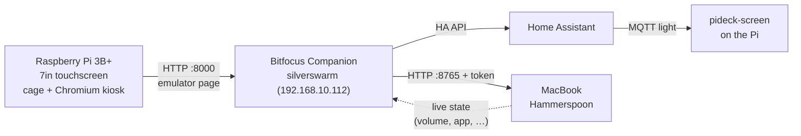

# PiDeck

A Raspberry Pi 3B+ with the official 7" touchscreen, used as a Stream Deck: a 5×3 grid of buttons for Home Assistant and the MacBook.

The Pi only shows buttons. [Bitfocus Companion](https://bitfocus.io/companion), running on the silverswarm cluster, holds every button and does the work. Companion isn't supported on a Pi 3B+, and keeping the Pi stateless means it can be reflashed in minutes and run read-only.



## Repository layout

| Path | What |
| --- | --- |
| [`pi/install.sh`](pi/install.sh) | Installs the kiosk and/or screen control on the Pi |
| [`pi/kiosk/`](pi/kiosk) | `pideck-browser` launcher + `pideck-kiosk.service` (cage + Chromium on the Companion emulator page) |
| [`pi/screen/`](pi/screen) | `pideck-screen`: backlight as an HA light over MQTT, wake on touch, optional idle dim |
| [`mac/hammerspoon/`](mac/hammerspoon) | Hammerspoon HTTP API for volume, brightness, apps, windows, media keys, plus live state to Companion |
| [`companion/`](companion) | Companion connections, custom variables and the Mac page layout |
| [`homeassistant/`](homeassistant) | Automations: night dim, morning restore, wake on presence, off when the room is empty |
| [`k8s/`](k8s) | Standalone Companion manifest (silverswarm itself uses `silverswarm/clusters` #1182) |
| [`docs/setup.md`](docs/setup.md) | Step-by-step setup |
| [`docs/troubleshooting.md`](docs/troubleshooting.md) | Known problems, including the touch/backlight I2C fault |

## Quick start (Pi)

```bash
git clone https://github.com/ronsilverentand/pideck.git && cd pideck
sudo ./pi/install.sh kiosk     # then: sudo ./pi/install.sh screen
```

## Status

- [x] Companion deployment specified (`silverswarm/clusters` #1182)
- [x] Kiosk on the Pi
- [x] MacBook control via Hammerspoon (tested)
- [ ] Touch and backlight: I2C fault on the display, see [troubleshooting](docs/troubleshooting.md)
- [ ] Screen control from HA: written and logic-tested, waiting on the I2C fix
